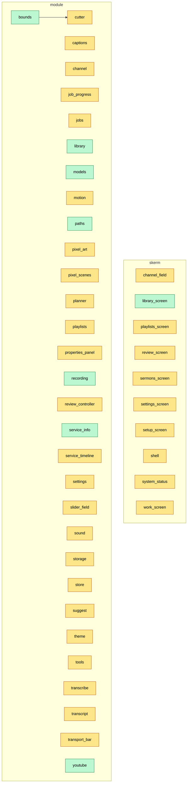

# Stelselkaart

## Breinkaart

- **ytsermon-prosessor** — 'n Selfstandige Windows-app (Flutter, installeerder-exe, geen Claude nodig) wat preke van @gereformeerdekerkoranjeriv5791 aflaai, tot die preek sny, Shorts maak, en met titels/beskrywings in snitlyste terug oplaai; ook klank vir WhatsApp uitvoer.
  - Werk wat jy aanvra
    - Die hele diens verstaan
    - Preekgrense: van gebed tot gebed
    - Verwerk nuutste diens
    - 'n Ou preek verwerk
    - Voer opname in
    - Die grense is onseker of verkeerd
    - Hervat ná 'n onderbreking
    - Eerste keer op die kerk-PC
    - en 3 ander
  - Waar die geheue leef
    - —
    - werkmap/<id>/ (info.json, onderskrifte, video.mp4)
    - <werkmap>/settings.json
    - out/<jaar>/<diens>/
    - <werkmap>/jobs.json
    - werkmap/<id>/plan.json, analysis.json
    - <werkmap>/<id>/plan.json (via die beheerder), instellings.json (uitvoere)
    - werkmap/opname-…/ (video.mp4, info.json, leë onderskrifte, plan.json, sermon.json)
    - en 6 ander
  - Die dele
    - Skerms
    - App-raam
    - Kern

## Vloeie

### Die hele diens verstaan

Die app hoor waar musiek en spraak is, benoem elke spraakstuk, en maak uit een diens drie uitvoere (volle preek, net die woord, sang) in een gids met 'n WhatsApp-teks.

Hoekom: Schalk wil die woord en die sang apart hê, en die diensorde verskil van week tot week; musiek uit die klank is betroubaarder as YouTube se merkers.

1. Klank — een ffmpeg-proses lees die klank, Dart klassifiseer elke sekonde as stilte/musiek/spraak/geraas; die uitslag word in sound.json bewaar (`lib/core/sound.dart:273–274`)
2. Spraakblokke — die woorde word gesny by musiek, 'n pouse van 3 s en "Amen"; elke blok kry later 'n etiket (`lib/core/captions.dart:197–200`)
3. Diensdatum — die dag en Oggend/Aand uit die stroom se begintyd (nie upload_date nie, wat 'n dag laat is); tema, Skriflesing en psalms uit die beskrywing (`lib/core/service_info.dart:80–120`)
4. KI-etikette — een Ollama-oproep sonder onderskrifte kry die blokke, liedere en beskrywing en gee net nommers terug (gebed voor en ná die preek); die blokke tussen die twee gebede word preek; die KI kies nooit tye nie (`lib/core/planner.dart:369–522`)
5. Grense uit etikette — preek = langste loop `preek`-blokke (≥ 15 min); begin by die eerste blok van die gebed daarvoor (terug tot by musiek), einde by die Amen van die gebed daarna; twyfel gee 'n rede vir Hersien (`lib/core/bounds.dart:53–60`)
6. Net die woord — alle spraak tussen die gebede (Skriflesing ingesluit), sonder gebede en sang, in een snit aanmekaar (`lib/core/bounds.dart:118–120`)
7. Kies die uitvoere — drie merkblokkies (almal aan, onthou in Instellings), Oggend/Aand en die soort diens; die sny gebruik dit (`lib/features/review/properties_panel.dart:486–546`)
8. WhatsApp-sjabloon — die teks met plekhouers en 'n voorskou met die nuutste preek (`lib/features/playlists/playlists_screen.dart:184–591`)
9. Uitvoere — `<uitgids>/<jaar>/<datum> <Oggend|Aand> - <tema>/` kry Volle preek.mp4, Net die woord.mp4, Sang/NN <lied>.mp3, WhatsApp.txt en diens.json (`lib/core/cutter.dart:414–415`)
10. Sny die uitvoere — Volle preek, Net die woord en Sang soos in Instellings gekies, in die diensgids; dan WhatsApp.txt en diens.json (`lib/core/jobs.dart:453–455`)
11. Kopieer WhatsApp-teks — die teks langs die uitvoere (WhatsApp.txt) op die knipbord, om saam met die klank te plak (`lib/features/work/work_screen.dart:621–631`)
12. Preke-aansig — per jaar, nuutste eerste; Speel, Wys in gids en Kopieer WhatsApp-teks per diens (`lib/features/library/library_screen.dart:118–171`)
13. Sang-aansig — alle liedere met naam, diens en datum; 'n soektog wys net die liedere wat pas (`lib/features/library/library_screen.dart:173–217`)

### Preekgrense: van gebed tot gebed

Die snit begin by die eerste woord van die gebed voor die preek en eindig ná die "Amen" van die eerste gebed daarna; kode kies dit, nie Ollama nie.

Hoekom: Ollama het die grense soms verkeerd gekies (of 30 min gedink); reëls oor woordtye en stilte is herhaalbaar en binne 0,5 s.

1. Stilte-snap — begin na die einde van die laaste stilte voor die eerste woord, einde by die begin van die eerste stilte ná "Amen" (ffmpeg silencedetect, ±3 s) (`lib/core/bounds.dart:175–178`)
2. Herkodeer — libx264 presies op die grense (nie -c copy nie, wat net op 'n sleutelraam sny) (`lib/core/cutter.dart:303–305`)

### Verwerk nuutste diens

Maandag: die diens van gister word een knoppie later 'n gesnyde preek met Shorts op YouTube.

Hoekom: die gewone week; Oom Johan moet dit sonder hulp kan doen, met net een gevulde knoppie op elke skerm.

1. Verwerk nuutste diens — Preke: een knoppie verfris die lys, beplan die boonste diens en maak Hersien oop (`lib/features/sermons/sermons_screen.dart:181–193`)
   - nog besig met beplan → Hersien wys die laaistap; geen internet → strook met die rede
2. Beplan — onderskrifte + video af; Ollama benoem die blokke, kode kies die grense (gebed tot gebed, stilte-snap), Ollama skryf net teks (`lib/core/jobs.dart:390–393`)
   - Ollama af → "Ollama het nie geantwoord nie" met Probeer weer in Werkry
3. Hersien — kyk die hakies by die gebede, die titel, Skriflesing en beskrywing (`lib/features/review/review_screen.dart:202–202`)
4. Sny — herkodeer presies van die eerste woord tot ná die Amen (met intro/outro en uitgeknipte stukke saamgevoeg); uitset in die uitsetgids (`lib/core/jobs.dart:451–451`)
5. Laai op — volle preek en Shorts na YouTube, in die regte snitlys (`lib/core/jobs.dart:659–661`)
   - kwota op → "probeer môre weer"; geen internet → Probeer weer

### 'n Ou preek verwerk

'n Diens van weke gelede wat nog nie opgelaai is nie, gevind met die filter "Nie opgelaai nie".

Hoekom: die agterstand van die kanaal word so een vir een ingehaal.

1. Filter nie opgelaai nie — die chip wys net preke wat nog nie op YouTube is nie, nuutste bo (`lib/features/sermons/sermons_screen.dart:561–789`)
2. Kies die ou preek — klik die ry → Hersien; nog nie beplan nie → Hersien beplan dit eers (laaistap) (`lib/features/sermons/sermons_screen.dart:791–848`)

### Voer opname in

'n Video wat nie op YouTube is nie (USB, kamera) word gekopieer, met die hand begrens en gesny.

Hoekom: soms faal die regstreekse uitsending; dan is die eie opname die enigste bron.

1. Voer opname in — lêerkieser of insleep → dialoog met titel (lêernaam) en datum (`lib/features/sermons/sermons_screen.dart:195–559`)
   - kanselleer → niks verander nie; kopie misluk (skyf vol) → strook met friendlyError
2. Kopieer en beplan — video.mp4, info.json, leë onderskrifte en 'n plan oor die hele lêer (`lib/core/recording.dart:24–26`)
3. Stel self — geen onderskrifte nie: die strook sê so; stel begin en einde met I/O by die speelkop (`lib/features/review/transcript.dart:39–149`)
4. Sny sonder YouTube — dieselfde snit; die opname het geen Shorts-onderskrifte nie (`lib/core/jobs.dart:452–452`)

### Die grense is onseker of verkeerd

Die kode het die gebede nie seker gevind nie (Hersien wys die rede), of die hakie staan nie by die gebed nie; die mens skuif dit met die transkripsie en die sleutelbord reg.

Hoekom: die grense kom uit reëls, nie 'n KI nie, maar is net so min onfeilbaar; die predikant wil nie 'n preek wat halfpad begin nie.

1. Sien die fout — 'n banier wys waarom die kode onseker is en spring na die grens; gebedsmerkers wys waar die gebede is (`lib/features/review/review_screen.dart:203–479`)
   - kode onseker → banier met die rede (ARB) en "Gaan na die grens"
2. Soek in die transkripsie — klik die gebed se reël; die video spring daarheen (`lib/features/review/transcript.dart:38–38`)
3. Skuif die hakie — sleep, ←/→ 1 s, Shift 0,1 s, of I/O by die speelkop (`lib/features/review/review_controller.dart:498–727`)
4. Ontdoen — Ctrl+Z draai die laaste skuif terug, Ctrl+Shift+Z herdoen (`lib/features/review/review_controller.dart:494–496`)
5. Beplan weer — loop die grense en die teks weer van voor af as die hele voorstel verkeerd is (bevestiging) (`lib/features/review/review_screen.dart:73–200`)

### Hervat ná 'n onderbreking

Die app of die krag gaan af in die middel van 'n aflaai of snit; by die volgende begin loop die werk voort.

Hoekom: 'n uur se aflaai mag nie verlore gaan nie, en niemand moet onthou wat besig was nie.

1. Hervat ná 'n onderbreking — jobs.json word gelees; 'n taak wat besig was, wag weer en loop van voor af (`lib/core/jobs.dart:157–326`)
2. Aflaai hervat — yt-dlp gaan voort met die halwe .part-lêer; 'n klaar video word oorgeslaan (`lib/core/channel.dart:178–180`)
3. Mislukte taak — rooi ikoon, die rede en Probeer weer (`lib/features/work/work_screen.dart:633–633`)

### Eerste keer op die kerk-PC

Ná Setup.exe bring die Opstelling-lys alles tot groen sonder 'n terminaal.

Hoekom: die kerk-PC het geen ontwikkelaar langsaan nie.

1. Begin op Opstelling — tot setupDone waar is, wys die app net die Opstelling-lys (`lib/app/shell.dart:106–418`)
2. Kontroleer — kyk wat klaar is: Ollama, model, kanaal, uitsetgids (`lib/features/setup/setup_screen.dart:70–80`)
3. Een knoppie op 'n slag — Begin Ollama → Laai model af → Koppel kanaal → Maak gids (`lib/features/setup/setup_screen.dart:82–97`)
   - geen kliënt-ID-lêer → "Gaan na Instellings"
4. Begin werk — aktief as alles groen is; gaan na Preke en verskyn nie weer nie (`lib/features/setup/setup_screen.dart:99–309`)

### Vinnige WhatsApp-klank

Die gesnyde preek word 'n mp3 wat die WhatsApp-admin in die groep sleep.

Hoekom: baie lidmate luister net op hul foon; die admin wil nie die app leer nie.

1. WhatsApp-klank — by die gesnyde preek in Werkry; een klik (`lib/features/work/work_screen.dart:564–564`)
2. Klank uitvoer — mp3 van Net die woord (of Volle preek as dit nie gesny is nie), langs die gesnyde video (`lib/core/jobs.dart:573–575`)
   - preek nog nie gesny nie → "Sny eers die preek"
3. Wys in gids — maak die gids met die mp3 oop om in WhatsApp te sleep (`lib/features/work/work_screen.dart:565–619`)

### Fout ná oplaai

Die titel of Skriflesing is verkeerd op YouTube; Hersien stuur die regstelling sonder om weer op te laai.

Hoekom: weer oplaai kos kwota en breek die skakel wat reeds gedeel is.

1. Maak reg — open die opgelaaide preek in Hersien en wysig titel of beskrywing (`lib/features/review/properties_panel.dart:278–484`)
2. Werk op YouTube by — knoppie verskyn net vir 'n opgelaaide preek; strook sê hoeveel video's (`lib/features/review/review_screen.dart:481–532`)
   - geen internet of video weg → strook met friendlyError
3. Stuur na elke opgelaaide video — titel en beskrywing uit die plan, per mp4-uitset (`lib/core/jobs.dart:633–634`)
4. YouTube PUT — haal die snippet, verander titel en beskrywing, stuur dit terug (`lib/core/youtube.dart:301–390`)
   - video weg → "Video … is nie meer op YouTube nie."

### Geen internet of vol skyf

'n Taak misluk; Werkry sê in gewone taal wat fout is en hoe om dit reg te stel.

Hoekom: "SocketException" sê niks vir Oom Johan nie; die regstelling moet in die boodskap staan.

1. Gewone-taal fout — internet, Ollama of vol skyf word elk sy eie sin met die regstelling (`lib/core/jobs.dart:121–122`)
2. Werkry wys die rede — die sin uit friendlyError onder die taak, met Probeer weer (`lib/features/work/work_screen.dart:634–682`)
3. Probeer weer — die mislukte taak staan weer in die ry, die werk tot dusver bly (`lib/core/jobs.dart:328–353`)

## Geheue

| Lêer | Wat dit hou | Wie skryf |
|---|---|---|
| `—` |  | bounds, captions, job_progress, library, library_screen, models, motion, paths, pixel_art, pixel_scenes, playlists, review_screen, sermons_screen, service_timeline, shell, slider_field, storage, system_status, theme, tools, transcript, transport_bar, work_screen |
| `werkmap/<id>/ (info.json, onderskrifte, video.mp4)` |  | channel |
| `<werkmap>/settings.json` | channelUrl, eers ná validering | channel_field, playlists_screen, settings, settings_screen, setup_screen, suggest |
| `out/<jaar>/<diens>/` | Volle preek.mp4, Net die woord.mp4, Sang/*.mp3, Shorts | cutter |
| `<werkmap>/jobs.json` | die ry; sermon.json van die preek wat verwerk word | jobs |
| `werkmap/<id>/plan.json, analysis.json` | die plan; die etikette van die spraakblokke, die liedere en die diens-soort | planner |
| `<werkmap>/<id>/plan.json (via die beheerder), instellings.json (uitvoere)` |  | properties_panel |
| `werkmap/opname-…/ (video.mp4, info.json, leë onderskrifte, plan.json, sermon.json)` |  | recording |
| `<app-support>/work/<id>/plan.json` | die plan; elke wysiging stoor dadelik | review_controller |
| `<werkmap>/<id>/service.json` | Oggend/Aand en diens-soort wat Schalk in Hersien kies | service_info |
| `<werkmap>/<id>/sound.json` | die klas van elke sekonde (stilte/musiek/spraak/geraas); sound.level.json | die dB per sekonde (golfvorm in Hersien) | sound |
| `<werkmap>/<id>/sermon.json` | atomies (.tmp, dan hernoem) | store |
| `<id>/<id>.local.json3` |  | transcribe |
| `refresh-token (deur die roeper: Windows Credential Manager / libsecret); <werkmap>/quota.json; <werkmap>/<id>/upload-*.json` | hervat-sessie | youtube |

## Dele

Pyl = roep; pyle wat ook via 'n ander hoofstuk loop, is weggelaat (volle lys in die tabel).

| Naam | Soort | Wanneer | Doel | Roep | Status | Lêer | Inhoud |
|---|---|---|---|---|---|---|---|
| bounds | module | ná die KI-etikette (Planner.analyse), in planJob (met die video af, vir die stilte-snap) | kies die snit-grense met reëls uit die etikette van die spraakblokke (die KI kies nooit tye): preek = langste loop preek-blokke, begin by die gebed voor, einde by die Amen van die gebed ná die preek; snapBounds pas albei by die naaste stilte aan (ffmpeg silencedetect) |  | klaar | `lib/core/bounds.dart` | sermonRuns, findBounds, musicBetween, wordParts, snapStart, snapEnd, snapBounds |
| captions | module | ná fetchMeta | json3-onderskrifte → segmente met woordtye, kompakte teks vir die KI (uit blokke), spraakblokke (pouse/Amen/musiek), SRT |  | bou | `lib/core/captions.dart` | parseJson3, formatTime, parseClock, compact, toSrt, wordsOf, blocks |
| channel | module | as 'n preek-URL gelaai word | lys die kanaal (flat; URL uit instellings, normaliseer), video-ID uit URL, haal metadata + af-orig-onderskrifte (ontbreek dit: geen fout, die plan transkribeer plaaslik), laai die video een keer af |  | bou | `lib/core/channel.dart` | ChannelItem, parseChannel, normalizeChannelUrl, channelName, listChannel, videoIdFromUrl, parseProgress, downloadDetail, FetchedMeta, fetchMeta, downloadVideo, InfoFields |
| channel_field | skerm | Opstelling en Instellings | veld "Jou YouTube-kanaal": normaliseer die invoer, valideer met een yt-dlp-oproep op versoek, wys "Gevind: naam" of 'n vriendelike fout |  | bou | `lib/features/settings/channel_field.dart` | ChannelField |
| cutter | module | by 'Keur goed en sny' en 'Klank vir WhatsApp' | gids per diens (serviceDir), sny Volle preek en Net die woord (herkodeer net die stuk met NVENC of libx264 (val terug by 'n NVENC-fout), of segmente plus intro/outro saamgevoeg), Shorts (9:16 met ingebrande onderskrif), elke lied as mp3 en WhatsApp-klank (mono mp3 64 kbps) met ffmpeg; skryf die WhatsApp-teks |  | bou | `lib/core/cutter.dart` | videoArgs, sermonFileName, sermonArgs, silenceArgs, shortArgs, audioArgs, MediaInfo, probeMedia, joinArgs, parseFfmpegProgress, cutParts, cutShort, cutAudio, serviceDir, songArgs, cutSong, longDate, whatsappText |
| job_progress | module | Werk-skerm, Hersien-laai, Opstel en oral waar iets wag | gedeelde vorderingswyer: stappelys van die taak se fases (huidige vet), balk met persentasie, detailreël, begintyd, onbepaald-met-woorde en uitvoubare besonderhede (laaste 20 reëls) |  | bou | `lib/app/job_progress.dart` | ProgressLine, stepsOf, MiniProgress, startedLabel, JobProgress |
| jobs | module | "Verwerk volgende", "Keur goed en sny", "Beplan weer", "Klank vir WhatsApp", "Laai op" en by begin (hervat) | een taak op 'n slag (plan: (geen af-orig: plaaslike transkripsie met whisper) klank → blokke → etikette → grense → stilte-snap; sny: die gekose uitvoere in die diensgids met WhatsApp.txt en diens.json; klank of oplaai), hervat ná herbegin, kanselleer, probeer weer |  | bou | `lib/core/jobs.dart` | JobKind, JobStatus, JobPhase, Job, JobCtx, friendlyError, JobQueue, checkWhisper, transcribeStep, planJob, cutJob, audioJob, updateOnYouTube, uploadJob |
| library | module | as die Biblioteek-skerm oopmaak of herlaai | lees elke <uitvoer>/<jaar>/<diens>/diens.json in een lys diens (nuutste eerste) met hul liedere; die blaaier soek daarin |  | klaar | `lib/core/library.dart` | LibrarySong, LibraryService, readService, loadLibrary, libraryWhatsapp |
| library_screen | skerm | Biblioteek (rail) | die dienste in die uitvoergids as Preke (per jaar, nuutste eerste) en Sang (alle liedere); soek op tema, skriflesing en liedname; Speel, Wys in gids, Kopieer WhatsApp-teks; laai by oopmaak en met Herlaai |  | klaar | `lib/features/library/library_screen.dart` | LibraryScreen |
| models | module | oral waar 'n plan gebruik word | Word, Segment (met woordtye), TimeBlock, Block/BlockLabel (spraakblok met etiket), Song, Bounds, Short, Span, SermonPlan (preek minus uitgeknipte stukke = segmente) met JSON |  | klaar | `lib/core/models.dart` | SegmentKind, Word, Segment, TimeBlock, BlockLabel, Block, Song, BoundsDoubt, Bounds, Short, Span, SermonPlan |
| motion | module | oral waar iets bykom, kom of tel (Werk-rye, suksesmerke, statusbalk) | klein bewegings-wyers deur die bewegingskonstantes: Reveal (rye vervaag en skuif in), PopIn (suksesmerk 0,9 na 1), CountText (getalle tel in 150 ms op); alles sonder beweging met disableAnimations |  | bou | `lib/app/motion.dart` | Reveal, PopIn, CountText |
| paths | module | by laai en sny | werkmap, gebundelde lettertipe en verstek-uitsetgids |  | klaar | `lib/core/paths.dart` | workRoot, bundledFont, defaultOutDir |
| pixel_art | module | vorderingswyer, leë toestande, statusbalk en opstelskerm | pixel-kuns uit karakter-roosters in Dart (geen beeldlêers): PixelSprite en PixelScene teken skerp vierkante op 'n heelgetal-skaal met 'n palet uit tema-rolle; een Ticker (≤8 rame/s) loop net as die toneel sigbaar en besig is, anders een stil raam |  | bou | `lib/app/pixel_art.dart` | Sprite, Placed, PixelSprite, PixelScene |
| pixel_scenes | module | Werk-skerm, statusbalk, opstelskerm en leë toestande | die tonele uit Bybelverhale as pixel-kuns, een per JobPhase en toestand (Abraham se sterre, Noag se duif, die wyse manne se karavaan, Nehemia se muur, Dawid se klippe en harp, Jakob se leer, skape in die ry, reënboog, Jona, die saaier, herder); geen beeld van God of Christus; mense klein en sonder gesigte |  | bou | `lib/app/pixel_scenes.dart` | phaseScene, flockScene, doneScene, sowerScene, restScene |
| planner | module | ná captions, een Ollama-oproep per preek | laat qwen3:8b net teks skryf (Shorts, titel, beskrywing) binne die snit wat findBounds reeds bepaal het (geen grense van die KI nie); analyse() benoem die spraakblokke en liedere (nooit tye); validate() toets die plan, shortFault() elke Short apart; gebed ná die preek begin by die gebedsopening naby die KI se gebed_na; berg plan.json op |  | bou | `lib/core/planner.dart` | PlanException, parseTime, validate, ShortFault, shortFault, savePlan, ollamaChat, Analysis, saveAnalysis, songStretches, Planner |
| playlists | module | by oplaai en in die Snitlyste-skerm se voorskou | snitlysnaam per preek uit reëls (Bybelboek, jaar), Schalk se eie snitlysgroepe (naam, beskrywing, preek-ID's) en die YouTube-beskrywing uit die jabloon |  | bou | `lib/core/playlists.dart` | bookFrom, playlistFor, PlaylistGroup, playlistsFor, describe |
| playlists_screen | skerm | Snitlyste (rail) | snitlysreëls aan/af en in volgorde, eie snitlysgroepe (skep, wysig, preke by, uitvee, KI stel preke voor), voorskou hoeveel preke in elke snitlys val, beskrywingsjabloon, WhatsApp-sjabloon met voorskou |  | bou | `lib/features/playlists/playlists_screen.dart` | PlaylistsScreen |
| properties_panel | module | Hersien-skerm (regs; onder 1280 breed in 'n laai) | twee oortjies (Inligting, Transkripsie); Inligting wys titel, beskrywing, uitvoere en die Shorts- en snitlyste, of net die Short/snit wat in die diensbaan gekies is (slider met syferveld); Herstel na die KI-voorstel |  | bou | `lib/features/review/properties_panel.dart` | PropertiesPanel |
| recording | module | by "Voer opname in" (knoppie of insleep op Preke) | 'n eie video-opname (nie op YouTube nie) word 'n preek met 'n plaaslike ID en 'n handmatige plan, sodat Hersien en sny dit soos enige ander preek hanteer |  | klaar | `lib/core/recording.dart` | importRecording |
| review_controller | module | Hersien-skerm | laai meta en plan van 'n preek uit die stoor en redigeer dit (hakies, gebedsmerkers uit die etikette (analysis.json), I/O, uitknip, Shorts, ontdoen/herdoen, voorskou van die snit); plaaslike transkripsie (whisper) kan die onderskrifte vervang (.bak bly); plan en sny loop deur die werkry |  | bou | `lib/features/review/review_controller.dart` | ReviewState, LoadStage, ReviewController |
| review_screen | skerm | Hersien (rail) | die preekredigeerder: preek uit Preke → plan → hakies, I/O, uitknip, transkripsie, Shorts, ontdoen (kortpaaie) → kies uitvoere, Oggend/Aand en soort diens (liedname op die tydlyn) → keur goed en sny |  | bou | `lib/features/review/review_screen.dart` | ReviewScreen |
| sermons_screen | skerm | Preke (rail, tuis) | die hele kanaal (uit instellings) as tabel (Titel, Datum, Lengte, Stand, Grootte; klik op opskrif sorteer) of rooster; filter (ook "Nie opgelaai nie"), soek; "Verwerk nuutste diens" → plan → Hersien; "Verwerk volgende" → werkry; "Voer opname in" (knoppie of insleep) → Hersien |  | bou | `lib/features/sermons/sermons_screen.dart` | stateLabel, stateIcon, SermonsScreen, SermonThumb, ViewToggle |
| service_info | module | ná fetchMeta (info.json) en in cutJob | diensdatum in plaaslike tyd (nie upload_date nie), Oggend/Aand en die velde uit die YouTube-beskrywing (tema, skriflesing, fokus, belydenis, psalms); Schalk se keuses oor Oggend/Aand en diens-soort |  | klaar | `lib/core/service_info.dart` | serviceStart, ServiceInfo, applyChoices, saveChoices |
| service_timeline | module | Hersien-skerm | bane met etiket (Klank = golfvorm uit sound.level.json, Diens = spraak/musiek, gebede, sleepbare preek-hakies (sleutels 1 s / Shift 0,1 s), uitgeknipte stukke gestreep en kiesbaar; Shorts = sleepbaar en kiesbaar, ongeldige met foutkleur; die gekose een kry dik buitelyn) en een oranje speelkop deur almal; zoem rol horisontaal |  | bou | `lib/features/review/service_timeline.dart` | ServiceTimeline, TracksPainter |
| settings | module | by begin gelaai; gestoor as Instellings of Snitlyste verander | Schalk se keuses: kanaal-URL, kliënt-ID-lêer, oplaai-privaatheid, beskrywingsjabloon, snitlysreëls en -groepe, uitsetgids, watter uitvoere 'n sny maak, WhatsApp-sjabloon, of Opstelling klaar is |  | bou | `lib/core/settings.dart` | AppSettings |
| settings_screen | skerm | Instellings (rail) | Jou YouTube-kanaal (ChannelField), Kanaal (kliënt-ID-lêer, Koppel/Ontkoppel, privaatheid van oplaaie), uitsetgids, intro/outro (met lengte) en Opstelling, bo die Stelsel-lys |  | bou | `lib/features/settings/settings_screen.dart` | SettingsScreen, pickVideoFile |
| setup_screen | skerm | eerste begin (setupDone vals); Instellings → Opstelling | Opstelling-lys: Ollama loop → model afgelaai → kanaal gekoppel (ChannelField) → uitsetgids, elk een knoppie; "Begin werk" as alles klaar is |  | bou | `lib/features/setup/setup_screen.dart` | SetupScreen |
| shell | skerm | by opstart | Sybalk (200 px, ikoon + woord, oranje streep) en inhoud as twee panele op die grond, statusbalk onder (keuse links, skyfspasie regs); sybalk: Preke (tuis), Hersien, Werk, Snitlyste, Biblioteek, Instellings (Kanaal + Stelsel); begin op Opstelling tot dit klaar is |  | bou | `lib/app/shell.dart` | Shell |
| slider_field | module | Hersien-skerm (eienskappe-paneel en vervoerbalk) | 'n slider met 'n syferveld langsaan: sleep werk die veld by, tik (23:04) werk die slider by; 'n ongeldige invoer wys 'n fout by die veld en verander niks |  | bou | `lib/features/review/slider_field.dart` | SliderField |
| sound | module | in planJob, ná die aflaai (die video is nodig) | een ffmpeg-proses gee 16 kHz-PCM; Dart bereken per sekonde lae-energie-rame, platheid en dB en klassifiseer in stilte/musiek/spraak/geraas (spektrogram, nie YouTube se [musiek]-merkers nie) |  | bou | `lib/core/sound.dart` | soundArgs, SoundFeatures, soundFeatures, analyseSound, classify, saveLevels, loadLevels, saveSound, loadSound, soundBlocks |
| storage | module | by laai en ná 'n taak | lêergroottes (som van 'n gids), SA-formaat "1,42 GB", en vrye skyfspasie (df / fsutil) |  | bou | `lib/core/storage.dart` | dirSize, sermonSizes, formatBytes, freeBytes |
| store | module | by begin (laai almal) en by elke toestandsverandering van 'n preek | elke diens as Sermon met toestand wat herbegin oorleef; voeg die kanaallys by en snoei ongeraakte preke van 'n vorige kanaal; 'n beskadigde sermon.json word oorgeslaan |  | bou | `lib/core/store.dart` | scriptureFrom, writeJson, SermonState, Sermon, SermonStore |
| suggest | module | Schalk vra "Stel preke voor" by 'n snitlysgroep; een keer ná elke klaar snit | vra Ollama (qwen3:8b) watter preke by 'n snitlysgroep pas, uit titel, Skriflesing, datum en die begin van die transkripsie; antwoord is JSON, onbekende ID's word weggelaat; GroupSuggestions vra ná 'n klaar snit (sonder dat die render wag) by watter groepe die preek pas en hoogstens een nuwe groepnaam, en hou dit in die geheue tot Aanvaar of Ignoreer |  | bou | `lib/core/suggest.dart` | Brief, SuggestException, wordBudget, cutWords, briefOf, suggestSermons, preek, suggestGroupsFor, GroupSuggestions |
| system_status | skerm | Instellings → Stelsel | wys yt-dlp/ffmpeg/ffprobe/Ollama en die video-enkodeerder (GPU/CPU) en die spraakmodel met ikoon + woord (Gereed / Ontbreek); "Laai spraakmodel af"; "Werk yt-dlp by" |  | bou | `lib/features/settings/system_status.dart` | updateYtDlpSnack, SystemStatus |
| theme | module | by opstart | ontwerpstelsel (Karoo-wit / Karoo-nag kleure, tipe, panele, seleksie), lig + donker |  | bou | `lib/app/theme.dart` | appPanel, motion, AppTokens, buildTheme |
| tools | module | by oopmaak van Instellings en voor elke aflaai/KI-oproep | kies video-enkodeerder (videoEncoder: NVENC as dit werk, anders libx264); vind yt-dlp/ffmpeg/ffprobe/ollama (langs die exe, Ollama se gids, PATH), loop eksterne prosesse (runTool), toets Ollama + qwen3:8b, laai die model af, begin Ollama; wys qjs.exe (QuickJS) as JS-looptyd aan yt-dlp as dit langs die exe lê |  | bou | `lib/core/tools.dart` | whisperModelFile, resetVideoEncoder, ollamaBase, findExecutable, JobCancelled, runTool, ToolStatus, openPath, updateYtDlp, probeOllama, pullModel, pullWhisperModel, startOllama, probeAll |
| transcribe | module | as 'n video geen af-orig-onderskrifte het nie, of as Schalk in Hersien plaaslik wil transkribeer | ffmpeg maak 16 kHz mono WAV, whisper-cli (whisper.cpp, taal af) transkribeer dit, die JSON word json3 in YouTube se vorm sodat captions/bounds/planner onveranderd werk |  | bou | `lib/core/transcribe.dart` | whisperToJson3, transcribeLocal |
| transcript | module | Hersien-skerm | transkripsiestrook: onderskrifreëls met tyd, klik soek daarheen, gebede gemerk, huidige reël uitgelig; kop met "Plaaslike transkripsie"-merk en "Transkribeer plaaslik"; leeg = stel self |  | bou | `lib/features/review/transcript.dart` | Transcript |
| transport_bar | module | Hersien-skerm (onder die voorskou) | vervoerbalk (speel/pouse, tyd, na die hakies, 5 s terug/vorentoe, klankvolume met demp, zoem met syferveld) en gereedskapbalk (I/O, knip uit, Short by, voorskou van die snit) |  | bou | `lib/features/review/transport_bar.dart` | TransportBar, ToolBar |
| work_screen | skerm | Werk (rail) | wys die werkry (lys of rooster, soos Preke): huidige taak met vordering en Kanselleer, wag- en fout-lyste, voorgestelde snitlyste (Aanvaar/Ignoreer), en die uitvoere in drie groepe (Volle preke, Shorts, Klank vir WhatsApp) met kies-alles en 'n aftreklys per groep (Laai op, Kopieer na gids, Wys in gids, Kopieer WhatsApp-teks, Klank vir WhatsApp); oplaai-teller |  | bou | `lib/features/work/work_screen.dart` | WorkGroup, WorkItem, WorkScreen |
| youtube | module | "Koppel kanaal" (Instellings) en die oplaai-taak in die werkry | desktop-OAuth (loopback + PKCE), hervatbare oplaai, snitlyste en die 100-per-dag-teller; net dart:io, endpunte uit die kliëntlêer sodat toetse 'n vals bediener gebruik |  | klaar | `lib/core/youtube.dart` | GoogleAuth, YouTube, QuotaExceeded, UploadQuota |
